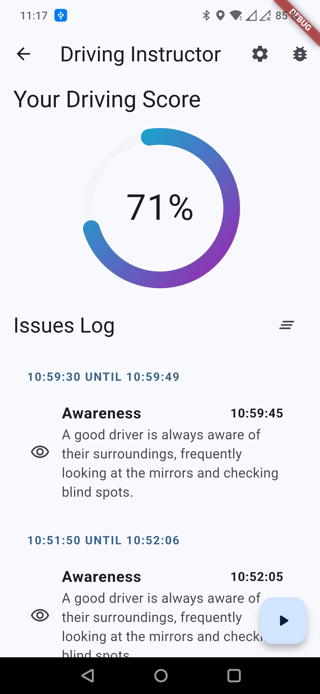
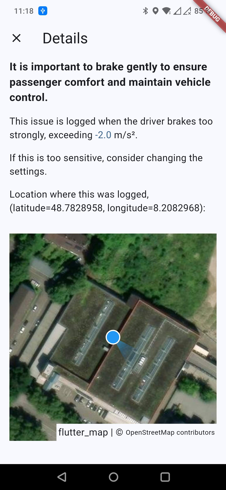
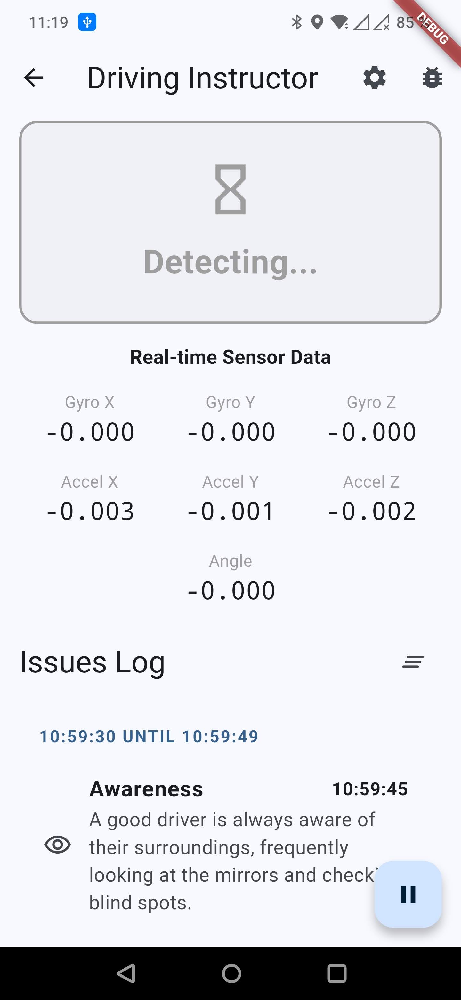
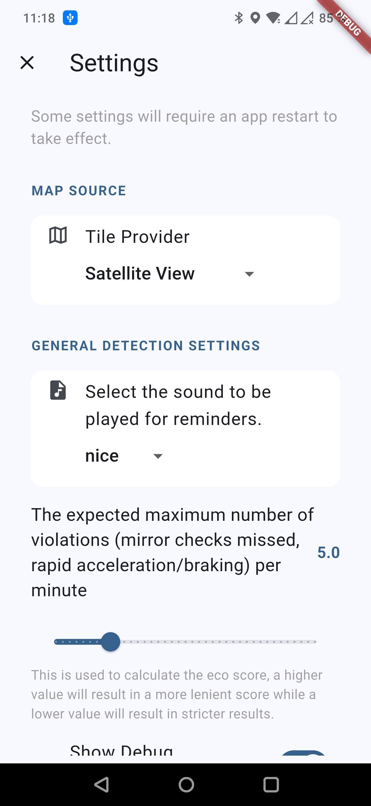
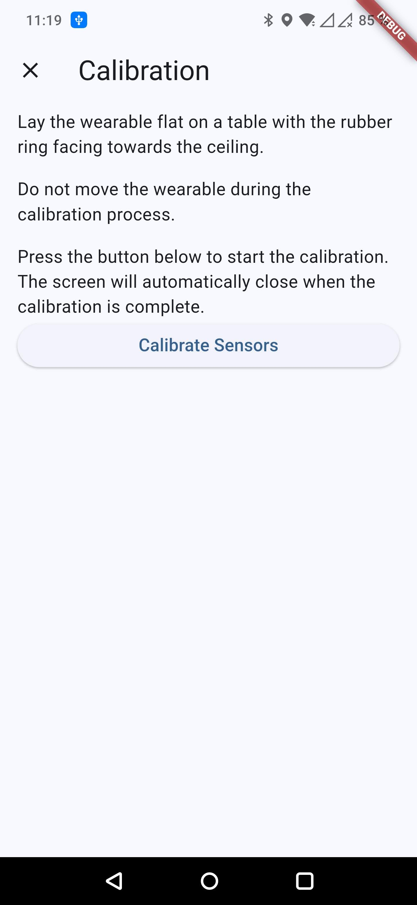
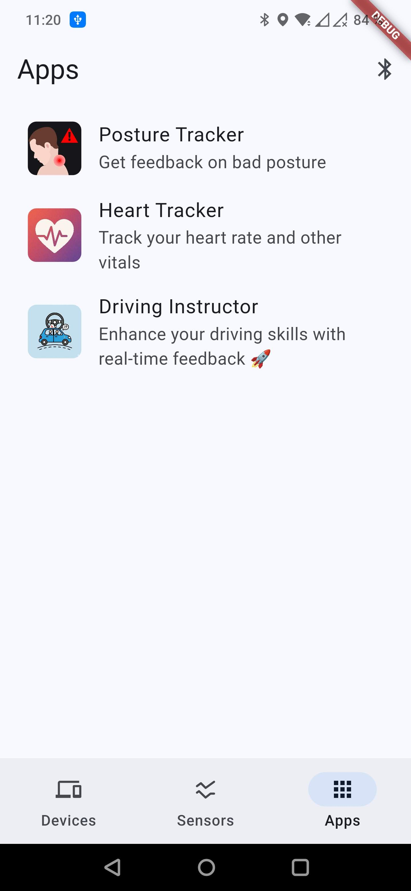

driving_instructor
===

This is an application based on the [OpenEarable framework](https://github.com/OpenEarable/open_earable_flutter)
that uses the esense headphone sensors to improve driving skills.

It has been a university assignment that required me to extend the base application
https://github.com/OpenEarable/app from which this project is forked with a new "sub-app"
that does something innovative with the sensors.

This application uses the headphones gyroscope to detect head turns and keep track
of how often a driver looks in the mirrors while driving.

If the driver doesn't look frequently enough, a warning is logged that influences
the score displayed on the main page:

Each time an issue is logged, the location is recorded as well, which will be displayed
in the details with an explanation about the issue:

This is the page that shows while a recording is in progress. 
The real-time sensor data might be hidden if the debug data has been disabled in the
settings.

The detection thresholds might vary depending on the headphone or user behaviour.
To accomodate this, there is an extensive settings menu in which most values can be
adjusted:

In addition to that, there is a calibration screen for calibrating the gyroscope offsets:

Besides detecting how frequently a driver looks in the mirrors, it also detects
how much the car accelerated/decelerated to log strong speeding/braking.

## Alert sounds

In the settings there is an option to enable a sound to be played whenever an issue has
been logged. The sounds are from

- https://freesound.org/people/ScottyD0ES/sounds/712995/
- https://freesound.org/people/Rolly-SFX/sounds/528651/
- https://freesound.org/people/martcraft/sounds/651627/
- https://freesound.org/people/SamsterBirdies/sounds/371177/
- https://freesound.org/people/Tissman/sounds/521850/
- https://freesound.org/people/LittleT1D/sounds/323018/
- https://freesound.org/people/KIZILSUNGUR/sounds/72127/
- https://freesound.org/people/greatsoundstube/sounds/629312/

these are all licensed under CC0.

The other sounds are from pixabay and different license terms apply.

## License

The template itself is licensed under MIT (see `LICENSE-TEMPLATE`). My own code,
which can be found in `open_wearable/lib/apps/driving_instructor` is licensed
under the license found in `LICENSE`.
